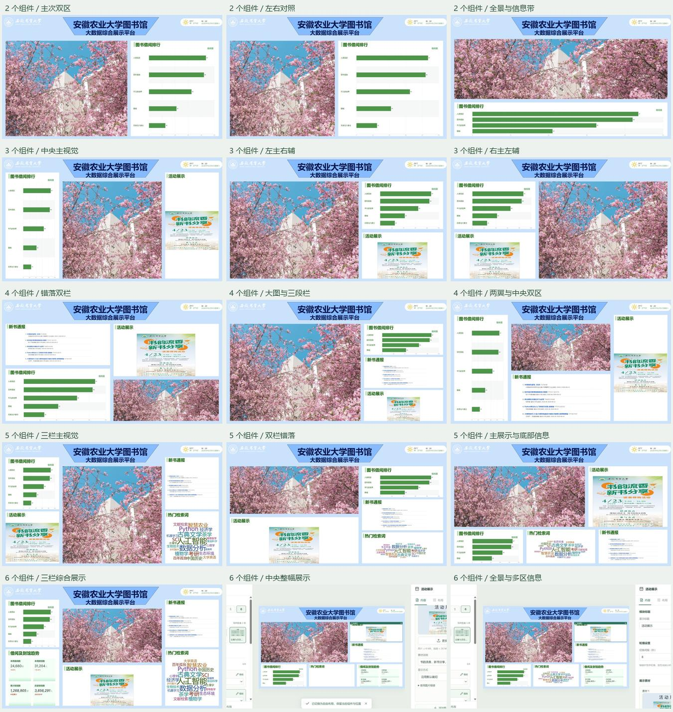

# 智慧图书馆前端大屏

Vue 3 + TypeScript + Vite + ECharts 5.6 / echarts-wordcloud。保留原 Figma 校标、图片、主题及 2560 × 1440 默认布局；检索词按用户提供的参考图改为彩色词云。

## 固定版位模板

编辑器左侧提供 **2、3、4、5、6 个组件各 3 套，共 15 套模板**，参考用户提供的《大数据展示平台模板.pptx》第 2–9 页的主图、纵栏、错落双栏和底部信息带结构。



1. 选择组件数量，再点击版式缩略图。
2. 在每个“位置”的下拉框中选择组件，或点击“编辑”修改内容。
3. 位置和大小由模板锁定，更换组件不会改变版式。选择已占用的组件会交换两个位置；选择“留空”后可从画布的添加按钮重新填入。
4. 直接预览、保存或发布。切换版式保留内容；切换到较少组件时，多余组件仅隐藏。

已有自由布局数据兼容保留。应用模板后隐藏拖拽和缩放手柄；“转为自由布局”保留当前组件与坐标并恢复手动工具。恢复默认布局会返回初始自由布局。

模板定义在 `src/data/layoutTemplates.ts`，全部使用固定的 2560 × 1440 坐标。`src/lib/templateLayout.ts` 负责初始组件分配、交换和生成规范布局；文档可选字段 `composition` 保存模板 ID 及各版位的组件 ID（留空为 null）。模板和组件变化均支持自动保存、撤销、备份及刷新恢复。

## 使用

本地预览：`http://127.0.0.1:4173/`。右下角“编辑大屏”进入编辑，也可使用 `?edit=1`。`?display=1` 打开没有编辑入口的展示页。

1. 默认使用左侧模板面板选择版式并为版位选择组件；点击“编辑”打开内容设置。
2. 如需手动调整，先转为自由布局，再通过勾选、拖拽或“布局”输入框操作。
3. 编辑词条、热度、颜色、标题、统计演示数据、通知、新书和图片/视频素材。
4. 点击“预览”查看当前草稿，“发布到展示页”更新此浏览器的展示内容。
5. 使用“导出”备份当前配置及上传素材，另一浏览器可通过“导入”恢复为草稿，再预览发布。

草稿自动保存。草稿与发布版本独立，刷新展示页只显示最近发布的内容；重新进入编辑会恢复草稿。支持 30 步撤销/重做、自动排列、隐藏后补位、恢复默认布局或全部内容。模块碰撞时尝试为相邻模块寻找空位，无法完整放入时保留原布局并提示。

词云字号随热度变化，使用每个词条的颜色，悬停显示数值；空词条和零热度不显示，最多 30 个词。模块尺寸变化会重新排布，长词及空间不足时可能收缩或省略。示例词条为演示数据。

图片支持 PNG/JPG/WebP/GIF ≤ 6 MB，视频支持 MP4/WebM ≤ 30 MB；轮播最多 12 份，编辑时暂停，展示时自动播放且视频静音。新书可切换图片或可编辑列表，通知和书目在空间不足时自动分页。

## 本地开发与检查

```powershell
npm install
npm run dev -- --host 127.0.0.1 --port 4173
npm test
npm run typecheck
npm run build
```

固定模板、组件交换、布局、校验、本地存储和素材备份测试使用 Node 24 原生 TypeScript 擦除与 fake-indexeddb。浏览器实际交互和视觉检查记录见 `design-qa.md`；临时检查截图保存在本机 `qa/`，不提交至仓库。

快捷键：Ctrl/Cmd+S 保存；Ctrl/Cmd+Z 撤销；Ctrl/Cmd+Shift+Z 或 Ctrl+Y 重做。自由布局中，模块获得焦点后方向键移动、Alt+方向键缩放、Shift 加速。输入内容时保留浏览器原生撤销行为。编辑器可选择适应窗口或 50%/75%/100% 画布缩放，窄屏使用抽屉式模块与设置面板。

## 代码组织

- `src/App.vue`：展示/编辑/预览切换与操作界面。
- `src/composables/useDashboardEditor.ts`：草稿、发布、历史记录、自动保存和导入导出。
- `src/lib/layout.ts`：尺寸边界、碰撞、补位和自动排列。
- `src/lib/validation.ts`：配置和素材地址校验。
- `src/components/editor/`：模块边框、设置、数据编辑和素材管理。
- `src/components/modules/`：纯展示模块，通过 props 接收内容。
- `src/services/localRepository.ts`：IndexedDB 文档、素材与可携带备份。
- `src/services/dashboardGateway.ts`：本地模式及待确认的 HTTP 适配入口。
- `src/data/`：默认配置、模块注册表和模拟内容。
- `public/assets/figma/`：已下载的原始素材，无临时 Figma 地址依赖。

## 接口与使用边界

没有真实接口，当前业务统计和天气均为演示内容；本地数据仅保存在当前浏览器、当前站点来源，清除站点数据会丢失，换设备请先导出备份。上传素材也保存在浏览器。远程素材、业务数据刷新、会话权限、跨设备同步和部署尚需与后端对接，具体约定见 `BACKEND_CONTRACT.md`。

`VITE_DASHBOARD_API_BASE_URL` 默认留空。远程适配器是提议，尚未联调；有本地素材时应先实现远程上传转换，再启用远程发布。`?display=1` 不构成安全鉴权。

原稿“借阅及到馆趋势”实际为四个统计卡片，“累计到馆数／册”的名称与单位暂按 Figma 保留，需由数据负责人确认。完整设计节点：<https://www.figma.com/design/68t5khLkCA9gmKAdpg6QEq?node-id=2005-331>。`?snapshot=figma` 冻结时钟，仅供视觉对照。

项目保留可选 Sites 构建适配文件，没有创建远程站点、部署或添加业务后端。
